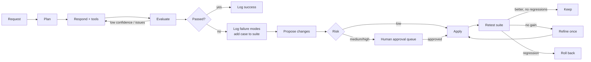

# Recursive AI

A modular assistant built on Claude that improves itself from its own
mistakes. Small, low-risk improvements apply automatically, but only if a
retest shows they help. Major or risky changes wait for a human.

## Quick start

```bash
cd recursive_ai
pip install -e ".[test]"

# No API key needed: deterministic offline model
python -m recursive_ai --offline ask "What is 12 times 7?"
python -m recursive_ai approvals
python -m recursive_ai --offline approve <ID> --note "looks right"

# Real model (Claude Opus 5.5). Uses ANTHROPIC_API_KEY or an `ant auth login` profile
python -m recursive_ai ask "Explain how a B-tree stays balanced."
python -m recursive_ai chat

# Learn without a human asking: practise questions with known answers
python -m recursive_ai practice --cases 5 --max-cost 1

pytest -q
```

The offline model is pattern matching, not intelligence. It exists so the
full loop (learning, retest, rollback, approvals) runs and is tested without
an API key.

## Components

| Layer | File | Job |
|---|---|---|
| Input / interface | `interface.py`, `__main__.py` | Validate input, CLI |
| Orchestrator | `orchestrator.py` | Run the pipeline, hand episodes to learning |
| Planner | `planner.py` | Short, tool-aware plan (structured output) |
| Responder | `responder.py` | Execute the plan, call tools |
| Memory | `memory.py` | Episodes, success/error patterns, regression suite |
| Tool router | `tools.py` | The only path to tools; default-deny permissions |
| Evaluator | `evaluator.py` | LLM judge + deterministic checks, tagged failure modes |
| Learning controller | `learning.py` | Propose, apply, retest, keep / refine / roll back |
| Safety / approval gate | `safety.py` | Risk rules, approval queue, audit log, content screen |
| Output | `output.py` | Answer + confidence + learning notes |
| Config | `config.py` | Versioned config; every change is a snapshot |
| Model | `llm.py` | `ClaudeLLM`, `OfflineLLM`, and the `Budget` spending cap |
| Practice set | `practice.py` | Questions with known answers for unattended learning |

## The loop



1. Receive request. 2. Plan and respond. 3. Evaluate with metrics.
4. Tag failure modes. 5. Propose a config change. 6. Classify risk in code.
7. Low risk: apply. 8. Medium/high: queue for a human.
9. Retest on the regression suite (always includes the failing case).
10. Keep if it scores better with no per-case regression; otherwise refine
once, then roll back. Changes that were rolled back or rejected are not
proposed again.

Self-correction per request: revise when confidence is low or checks fail
(up to `self_correction.max_revisions`); compare several candidates when the
planner rates a request high-complexity.

## Unattended learning

`practice` works through questions with known answers (40 in `practice.py`,
plus the seed cases), least recently practised first, and learns from the
ones it gets wrong. Self-correction never sees the known answer: it is
checked once, at the end, as a whole word or number ("391" does not match
"3910"). The issue it raises does not quote the answer, so the learner
cannot memorise it. Retests prefer cases with known answers, so a change has
to fix real answers, not just please the LLM judge.

An issue that keeps coming back on answers that pass (`ungrounded_math`,
`low_confidence`, `tool_error`, `permission_denied`) also triggers learning
once it has come up `learning.recurring_issue_threshold` times (default 3)
since it was last addressed. Like the rest of `learning`, only a human can
change that number.

## Spending cap

Every command that calls the model stops once its estimated spend reaches
`--max-cost` (US dollars, default 1.00) or it has made `--max-calls`
(default 300), whichever comes first, and exits with code 3. The last call
can take it slightly over. Spend is estimated from each response's token
usage at the model's list price. A change whose retest is cut short is
rolled back and not counted as failed; an approved one goes back in the
approval queue. Learning is the expensive part: one failure can retest two
changes on up to `learning.max_benchmark_cases` cases each.

## Risk rules

The rules are in `safety.py`, not in the config, so the system cannot edit
them. The proposer's own risk rating can raise the risk, never lower it.

| Change | Risk | Path |
|---|---|---|
| Append a short guidance line to `prompt_addenda.*` | Low | Auto, retested |
| Add a routing rule for an already-permitted tool | Low | Auto, retested |
| Small tune of `memory_policy` / `self_correction` within bounds | Low | Auto, retested |
| Long text, removals of rules, out-of-bounds numbers | Medium | Human |
| `safety_policy`, `tool_permissions`, `memory_schema`, `planner` | High | Human |
| `prompts` (base prompts), `evaluator` (metrics) | High | Human |
| Any value mentioning safety, approval, permissions, bypass | High | Human |
| Unknown target | High | Human (fail closed) |
| `learning` section, `version` | Locked | Rejected; humans edit `config.json` directly |

Other guarantees:

- High risk never auto-applies, whatever `learning.auto_apply_max_risk` says.
- Only the CLI `approve` command applies a queued change. Approved changes
  are still retested and rolled back if they break the suite.
- Every proposal, apply, retest, approval and rollback goes to
  `audit.jsonl`. Config history is append-only (`history`, `rollback N`).
- Chat requests to bypass approval or safety are refused.
- A memory file with a different schema version will not load.

## State

Stored in `--state-dir` (default `.recursive_ai_state/`): `config.json`,
`config_history/`, `memory.json`, `approvals.json`, `audit.jsonl`.

## Claude API settings

`ClaudeLLM` uses `claude-opus-5-5` with structured outputs, strict tool
schemas, prompt caching, an explicit effort level per call site, and the
server-side refusal fallback (`fallbacks: "default"`). A refusal or API error
is reported to the user and logged as a failure pattern. Each retest runs
the pipeline on up to `learning.max_benchmark_cases` cases, so learning
spends extra API calls when it triggers.
